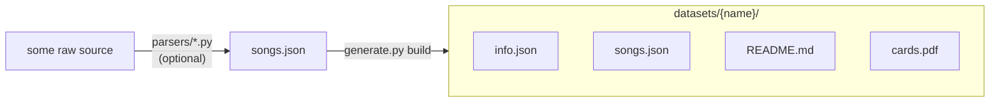

# TrackStar dataset generator

Turns a list of songs into a dataset the TrackStar app can load, plus a printable card sheet.

```bash
pip install -r requirements.txt
```

## Pipeline



1. **Parse** (optional): a parser script turns a raw source into `songs.json`. Write one by yourself for a datasource
2. **Build**: `generate.py build` turns `songs.json` into a dataset folder the app can load.

### 1. `songs.json`

The generator only reads a `songs.json`:

```json
[
  { "id": 1, "title": "Tim McGraw", "artist": "Taylor Swift", "year": 2006, "album": "Taylor Swift" }
]
```

`id`, `title` and `artist` are required, `year` and `album` are optional. Ids must be unique; they are what the QR codes point to. Unknown keys are ignored.

> **You don't need a parser to add a new dataset.** Write a `songs.json` in this format (by hand, in a spreadsheet exported to JSON, or with any tool you like) and run `build` on it:
>
> ```bash
> python generate.py build my-songs.json --name my-songs --display-name "My Songs"
> ```

Parsers are only a convenience for turning an existing raw source into a `songs.json`. They aren't part of the generator: each one is a standalone script that needs only Python's standard library and can be run from any directory.

| parser                    | input |
|---------------------------|-------|
| `parsers/hitster_csv.py`  | Hitster card list (`Card#, Title, Artist, Year` columns), default `parsers/resources/hitster-de.csv` |
| `parsers/taylor_swift.py` | album/lyrics dump, default `parsers/resources/album-song-lyrics.json` |
| `parsers/charts.py`       | yearly chart dump (`Rank, Year, Artist, Song Title, Album`) + `parsers/resources/chatgpted_data.py` |

```bash
python parsers/hitster_csv.py [input] -o songs.json
```

To support a new source, add another script that writes the same format.

### 2. `build` – `songs.json` → dataset folder

```bash
python generate.py build songs.json --name taylor-swift --display-name "Taylor Swift"
```

- `--name`: dataset identifier in lowercase kebab-case (`hitster`, `taylor-swift`). It is used as the folder name, in `info.json` and in every QR code.
- `--display-name`: what the app shows.
- `--output`: parent directory, defaults to `../datasets`.
- `--increase`: raise the version even if nothing changed, so every app downloads the dataset again (see [Versioning](#versioning)).

Optionally add `"icon"` to `info.json` by hand: an [SF Symbol](https://developer.apple.com/sf-symbols/) name (`"guitars"`) or an emoji (`"🇩🇪"`). Without one the app shows the first letter. Changing it needs no version bump; `build` keeps it.

For one artist's songs add `"type": "artist"`: the app lists the pack under Artists, and the Party Game places cards by album instead of year. The album order is the order the albums first appear in `songs.json`, so list the songs album by album, oldest first (re-recordings like Taylor's Version go where the original was).

Re-running `build` overwrites `info.json`, `songs.json` and `cards.pdf`; an existing `README.md` is kept.

### 3. `rebuild` – regenerate `cards.pdf`

```bash
python generate.py rebuild [NAME ...] [--increase] [--datasets ../datasets]
```

Re-renders the cards of the named datasets (e.g. `rebuild 90s-hits`), or of every existing dataset if no name is given, with the current card design (`card-design.json`). Use it after changing the layout, colours or fonts, so every dataset's PDF uses the new design.

After editing a dataset's `songs.json` in place, add `--increase` so the version goes up and the app downloads the change:

```bash
python generate.py rebuild 2000s-throwbacks --increase
```

## Versioning

`info.json` has a `version` number. `build` raises it by 1 whenever the songs or the display name change, and leaves it alone otherwise. A new dataset starts at version 1.

To update a dataset: edit its `songs.json`, run `build` again, commit and push.

```bash
python generate.py build ../datasets/taylor-swift/songs.json --name taylor-swift --display-name "Taylor Swift"
```

Changes to `cards.pdf` alone (for example a new card design) don't raise the version, because the app doesn't need to download anything new to play.

To raise the version without changing anything, for example to make every app download a dataset again after fixing a broken upload, add `--increase`:

```bash
python generate.py build ../datasets/taylor-swift/songs.json --name taylor-swift --display-name "Taylor Swift" --increase
```

## Dataset folder

| file          | used by | content |
|---------------|---------|---------|
| `info.json`   | app     | `{"name": ..., "display_name": ..., "version": ..., "icon"?: ..., "type"?: "artist"}` |
| `songs.json`  | app     | the song list |
| `cards.pdf`   | app (download link), printing | the cards |
| `README.md`   | app     | description + copyright note |

The app loads a dataset from its GitHub folder URL and looks for exactly these file names.

## Cards

`cards.pdf` is A4 with 12 cards (6.5 × 6.5 cm) per sheet, and every sheet is two pages:

- **Front:** a QR code that encodes `trackstar://<name>/?id=<id>`, plus the card number.
- **Back:** artist, year and title (and album when it differs from the title) on a gradient. A song without a year shows its title large in the middle on a neutral slate gradient. The gradient changes every 5 years, so cards from the same period share a colour. The front has no colour, so it doesn't hint at the year.

Print **double-sided, flip on long edge**. The backs are mirrored so each back lands behind its front. Cut along the marks in the margins.

When the app scans a code, it reads the number after `id=` and plays that song from the active dataset.

## Card design format

The card design lives in one file, [`TrackStar/Resources/CardDesign/card-design.json`](../TrackStar/Resources/CardDesign/card-design.json), next to the fonts it uses. Two renderers draw the same PDF from it:

- `cards.py` (reportlab) for the datasets in this repo
- `TrackStar/Datasets/CardPrinter.swift` (CoreGraphics) for datasets made in the app (Apple Music, imported files)

The app also takes its period colours from this file. To change the design, edit the JSON and run `rebuild`. To add a new kind of element or rule, change **both** renderers and this section.

### Units

Lengths are **mm**. Font `size`, `minSize` and `lineWidth` are **pt**. Element coordinates are measured from the card's top-left corner, with y pointing down. Colours are `#RRGGBB` or a name from `colors`.

### Top level

| key | meaning |
|---|---|
| `format` | format version, currently `1` |
| `title` | PDF title; `{label}` is the dataset's display name |
| `fonts` | font key → TrueType file next to the JSON. Both renderers embed these files, so the glyphs and their widths are identical |
| `colors` | colour names |
| `periods` | back gradient: `step` years per period, `colors` maps a period's first year → `[start, end]`, `none` is used when a song has no year. A year maps to `year // step * step`, clamped to the first and last key |
| `sheet` | `page` `[w, h]`, `card` side length, `cols` × `rows` cards per page, `grid` (`color`, `lineWidth`; drawn on fronts only), `cutMarks` (`color`, `lineWidth`, `edge` `[x, y]` distance from the paper edge, `gap` from the cards) |
| `front`, `back` | element lists, drawn in order |

### Elements

Each element is an object, and the key it has decides what it draws. Every element can have `if`: a list of conditions that must all hold. A condition is `field` (the field is set), `!field` (it isn't), or `a != b` (the two fields differ).

The fields are `dataset`, `id`, `title`, `artist`, `year` and `album`. A missing field is `""`. Strings substitute `{field}` in one pass.

| element | keys |
|---|---|
| `rect` `[x, y, w, h]` | outline; `radius` (circular corners), `stroke`, `lineWidth` |
| `gradient: "period"` | fills the card with a linear gradient of the song's period colours from `from` `[x, y]` to `to`, extended past both ends |
| `rings` `[cx, cy]` | `count` circles with radius `radius + i * step`; `stroke`, `opacity`, `lineWidth` |
| `qr` | the encoded string; `rect` `[x, y, w, h]` (uses `w`), `color` |
| `text` | the string; `font` (a key of `fonts`), `size`, `minSize` (default `size`), `maxLines` (default 1), `box` `[x, centerY, w]`, `align` `left`/`center`/`right` (default center), `color`, `opacity` (default 1) |

Every card is clipped to its square. Each page draws its sheet lines first (the grid on fronts, then the cut marks), then its cards. The cards fill the grid row by row. On the back page the columns are mirrored.

### Rendering rules both renderers follow

These rules are what make the two PDFs identical. They are not left to either library:

- **Text cleanup:** tab, CR and LF become spaces. Unicode format characters (category `Cf`, e.g. U+200E) are dropped. Leading and trailing spaces are trimmed.
- **Width:** the sum of the font's hmtx advance for each Unicode scalar (glyph 0 if the font lacks it), with no kerning or ligatures. Glyphs are placed at exactly these advances.
- **Wrap:** split on spaces, dropping empty words. Words are greedily joined with one space while the line still fits `w`. A word wider than `w` gets its own line and is clipped by the card.
- **Fit:** starting at `size`, shrink in 0.5 pt steps while there are more than `maxLines` lines and the next step stays ≥ `minSize`. If there are still too many lines, keep `maxLines` lines and drop scalars from the end of the last line until it plus `…` fits, then trim trailing spaces and append `…`.
- **Vertical position:** the leading is `1.15 × size`, and the first baseline is at `centerY − (lines − 1) × leading / 2 + 0.35 × size`.
- **QR code:** byte mode (UTF-8), error correction M, the smallest version that fits, and the mask with the lowest penalty (first one on ties; scoring in `_penalty`). No quiet zone. Modules are filled squares.
- **Shapes:** circles and rounded corners are circular arcs, drawn as standard cubic Béziers. Colours are DeviceRGB.

The PDFs aren't byte-identical, because each library writes its own file structure and font subsets. The geometry is the same: identical coordinates, line breaks, font sizes and QR modules. To check after a change, render the same songs with both and compare.

## Files

| file                | content |
|---------------------|---------|
| `generate.py`       | command-line interface (`build`, `rebuild`) |
| `songs.py`          | `Song` model, `songs.json` load/save |
| `cards.py`          | PDF rendering of `card-design.json` (run it to self-check) |
| `parsers/*.py`      | standalone scripts: raw source → `songs.json` |
| `parsers/resources/` | raw source files for the parsers |
