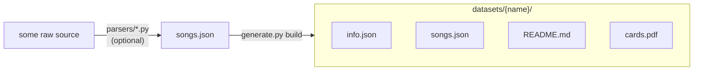

# TrackStar dataset generator

Turns a list of songs into a dataset the TrackStar app can load, plus a printable card sheet.

```bash
pip install -r requirements.txt
```

## Pipeline



1. **Parse** (optional): a parser script turns a raw source into `songs.json`. Write one by yourself for a datasource
2. **Build**: `generate.py build` turns `songs.json` into a dataset folder the app can load.

### 1. `songs.json`

The generator only reads a `songs.json`:

```json
[
  { "id": 1, "title": "Tim McGraw", "artist": "Taylor Swift", "year": 2006, "album": "Taylor Swift" }
]
```

`id`, `title` and `artist` are required, `year` and `album` are optional. Ids must be unique; they are what the QR codes point to. Unknown keys are ignored.

> **You don't need a parser to add a new dataset.** Write a `songs.json` in this format (by hand, in a spreadsheet exported to JSON, or with any tool you like) and run `build` on it:
>
> ```bash
> python generate.py build my-songs.json --name my-songs --display-name "My Songs"
> ```

Parsers are only a convenience for turning an existing raw source into a `songs.json`. They aren't part of the generator: each one is a standalone script that needs only Python's standard library and can be run from any directory.

| parser                    | input |
|---------------------------|-------|
| `parsers/hitster_csv.py`  | Hitster card list (`Card#, Title, Artist, Year` columns), default `parsers/resources/hitster-de.csv` |
| `parsers/taylor_swift.py` | album/lyrics dump, default `parsers/resources/album-song-lyrics.json` |
| `parsers/charts.py`       | yearly chart dump (`Rank, Year, Artist, Song Title, Album`) + `parsers/resources/chatgpted_data.py` |

```bash
python parsers/hitster_csv.py [input] -o songs.json
```

To support a new source, add another script that writes the same format.

### 2. `build` – `songs.json` → dataset folder

```bash
python generate.py build songs.json --name taylor-swift --display-name "Taylor Swift"
```

- `--name`: dataset identifier in lowercase kebab-case (`hitster`, `taylor-swift`). It is used as the folder name, in `info.json` and in every QR code.
- `--display-name`: what the app shows.
- `--output`: parent directory, defaults to `../datasets`.
- `--increase`: raise the version even if nothing changed, so every app downloads the dataset again (see [Versioning](#versioning)).

Re-running `build` overwrites `info.json`, `songs.json` and `cards.pdf`; an existing `README.md` is kept.

### 3. `rebuild` – regenerate all `cards.pdf`

```bash
python generate.py rebuild [--datasets ../datasets]
```

Re-renders the cards of every existing dataset with the current card design in `cards.py`. Use it after changing the layout, colours or fonts, so every dataset's PDF uses the new design.

## Versioning

`info.json` has a `version` number. `build` raises it by 1 whenever the songs or the display name change, and leaves it alone otherwise. A new dataset starts at version 1.

To update a dataset: edit its `songs.json`, run `build` again, commit and push.

```bash
python generate.py build ../datasets/taylor-swift/songs.json --name taylor-swift --display-name "Taylor Swift"
```

Changes to `cards.pdf` alone (for example a new card design) don't raise the version, because the app doesn't need to download anything new to play.

To raise the version without changing anything, for example to make every app download a dataset again after fixing a broken upload, add `--increase`:

```bash
python generate.py build ../datasets/taylor-swift/songs.json --name taylor-swift --display-name "Taylor Swift" --increase
```

## Dataset folder

| file          | used by | content |
|---------------|---------|---------|
| `info.json`   | app     | `{"name": ..., "display_name": ..., "version": ...}` |
| `songs.json`  | app     | the song list |
| `cards.pdf`   | app (download link), printing | the cards |
| `README.md`   | app     | description + copyright note |

The app loads a dataset from its GitHub folder URL and looks for exactly these file names.

## Cards

`cards.pdf` is A4 with 12 cards (6.5 × 6.5 cm) per sheet, and every sheet is two pages:

- **Front:** a QR code that encodes `trackstar://<name>/?id=<id>`, plus the card number.
- **Back:** artist, year and title (and album when it differs from the title) on a gradient. A song without a year shows its title large in the middle on a neutral slate gradient. The gradient changes every 5 years (`PERIOD_COLORS` in `cards.py`), so cards from the same period share a colour. The front has no colour, so it doesn't hint at the year.

Print **double-sided, flip on long edge**. The backs are mirrored so each back lands behind its front. Cut along the marks in the margins.

When the app scans a code, it reads the number after `id=` and plays that song from the active dataset.

## Files

| file                | content |
|---------------------|---------|
| `generate.py`       | command-line interface (`build`, `rebuild`) |
| `songs.py`          | `Song` model, `songs.json` load/save |
| `cards.py`          | PDF rendering |
| `parsers/*.py`      | standalone scripts: raw source → `songs.json` |
| `parsers/resources/` | raw source files for the parsers |
